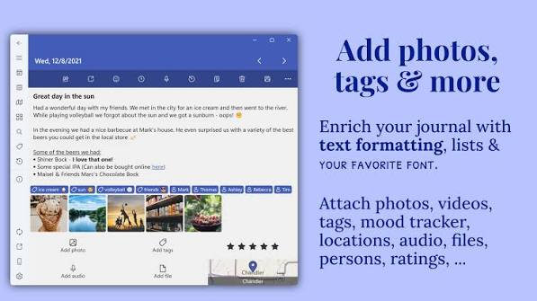
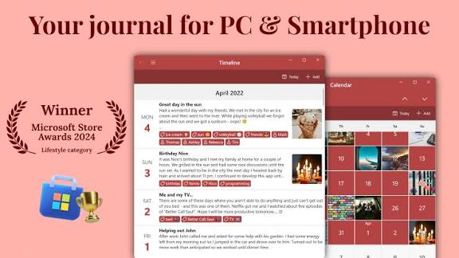
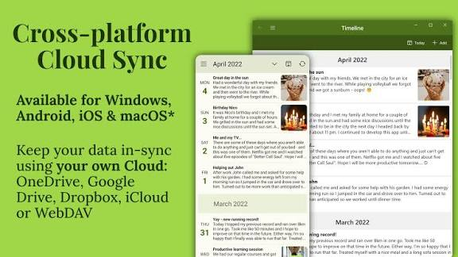

# Diarium Journal



Diarium Journal is a diary you write on your own devices. Diarium Windows, Mac, iPhone, and Android all open the same kind of day page. You can start without creating an account on a vendor server.

diarium cloud sync uses storage you already have. OneDrive, Google Drive, Dropbox, iCloud, or WebDAV can hold the journal. The app does not ask you to invent a new login just to keep yesterday's page.

On Windows the app is a paid upfront purchase. The brief describes no subscription, no ads, and no separate Pro upgrade on that desktop build. Phones and Mac can be downloaded free. diarium pro is the optional one-time unlock for those editions. This page does not invent a dollar figure. The store listing is where the current price sits.

## Features

A day is the unit. You open a date, write, and leave. The next morning is a new page, not a new notebook. Photos and text live in the entry. Tags help you find a trip or a habit later.

The editor surface is [DiaryEditor.tsx](editor/DiaryEditor.tsx), with the toolbar in [EditorToolbar.tsx](editor/EditorToolbar.tsx) and the title line in [TitleEditor.tsx](editor/TitleEditor.tsx). Tags on an entry are `EntryTags.tsx`. A word count sits in `WordCount.tsx`.

| Edition | How you pay | Where it runs |
| --- | --- | --- |
| Diarium Windows | Paid once, no subscription in the brief | Windows |
| Mac | Free download, optional one-time diarium pro | macOS |
| iPhone and iPad | Free download, optional one-time diarium pro | iOS |
| diarium android | Free download, optional one-time diarium pro | Android |

| You can take out | Shape |
| --- | --- |
| A Word file | For a document you want to print |
| HTML | For a browser or a static page |
| JSON | For a structured backup |
| Plain text | For a file you can open anywhere |

Imports named in the brief come from Day One, Daylio, and Evernote. The Day One path in this tree is `dayone.rs`. JSON export and import sit in `json.rs` and [json.ts](diary/json.ts). Markdown export is [md.ts](editor/md.ts). A PDF path is [pdf.ts](diary/pdf.ts). Merging two files of entries is `mergeEntries.ts`.

Integrations can pull steps, workouts, tasks, or a code streak into the day. The brief names Google Fit, Strava, Fitbit, Todoist, GitHub, and Microsoft To Do. Those are optional. A journal that never connects them is still a journal.

A template, if the build offers one, is a starting shape for the page. It is not a requirement. Some days are three sentences. Some days are a list of what you ate and where you walked. The calendar should accept both.

Photos belong in the entry when they explain the day. They also make the sync folder heavier. A cloud that is almost full will stall diarium cloud sync before it stalls typing. Leave room, or export old years and thin the live file.

diarium android is the same diary on a smaller screen. Write the short note on the phone. Expand it later on Diarium Windows if you want a keyboard. Do not keep a second unofficial diary app in the middle, or you will merge by hand.

Search across days is `SearchBar.tsx`. The diary page shell is [Diary.tsx](diary/Diary.tsx). Store wiring for entries is `store.ts` and `actionCreators.ts`.



The editor is where the sentence is written. Lock the journal when you stand up. Windows Hello, a PIN, a password, or another biometric can guard it. The security tab is [PreferencesSecurityTab.tsx](prefs/PreferencesSecurityTab.tsx). Changing the password is [ChangePasswordForm.tsx](prefs/ChangePasswordForm.tsx). A password preference screen is `PasswordPref.tsx`.

## Philosophy First

The product is a diary, not a social network. Entries are yours. Sync, when you turn it on, is diarium cloud sync through your own folder. There is no requirement to open a Diarium account before the first sentence.

Security should be boring. A password, a PIN, or Windows Hello wraps the journal. Losing every unlock method means the vendor cannot read the pages back to you. Write the password down somewhere that is not the only copy inside the locked journal.

Easy in and easy out matters. Word, HTML, JSON, and plain text are the export doors in the brief. A journal you cannot leave is a trap. Keep a copy of an export on a disk you control, not only inside the sync folder.

Focus is the other half. Templates exist as a search topic, but the daily job is still one page. Integrations decorate the day. They do not replace the paragraph you meant to write.

A streak is optional. Missing a day does not delete the journal. The calendar should show the gap without scolding you. People quit diaries that punish a blank Tuesday. Diarium Journal is more useful if Monday's page is still easy to find on Friday.

If you write at night, the date might already have rolled over. Check the heading before you save a paragraph onto tomorrow. Moving an entry to the right day is easier than discovering it a month later under the wrong number.

## Background

Diarium Journal won a Microsoft Store lifestyle award in 2024, according to the brief. That is a store prize, not a promise that every feature is free. Diarium Windows remains the paid desktop seat. The phone apps can stay on the free download until you want diarium pro.

People compare it with other diaries because it covers Windows and phones in one habit. The comparison only helps if you care about your own cloud folder and a lock screen. If you want a paper notebook, no app is the right tool.

The award in the brief is not a feature list. Lifestyle category means the store noticed the app. It does not mean every integration is turned on by default. Connect a service only if you want that data inside a private page. A step count you did not ask for is noise.

Keep the journal file name stable. Renaming it inside the cloud client while the app is open can look like a vanished diary. Close Diarium, rename if you must, then point the app at the new path. Do this on one device and let the others catch up.

The window that hosts the desktop UI is `window.ts`. Spellcheck beside the editor is `SpellcheckPref.tsx`. Theme choice is `ThemePref.tsx`. Preference load and save is [preferences.ts](prefs/preferences.ts).

## Keyboard Shortcuts

The brief does not publish a full chord list. Do not treat a shortcut table from another diary as the Diarium one. What this product does document is the lock and the platforms.

| Action | Where it lives |
| --- | --- |
| Write today's page | The open journal |
| Move to another day | The calendar |
| Lock the journal | Password, PIN, biometrics, or Windows Hello |
| Sync | Your OneDrive, Drive, Dropbox, iCloud, or WebDAV folder |
| Export | Word, HTML, JSON, or plain text |

On a desktop keyboard, the editor still uses ordinary typing keys. Calendar jumps are on-screen controls until you confirm chords inside the app you installed. Diarium Windows and the phone apps do not have to share one identical shortcut row. Check the build you are holding.

Date labels for the calendar are [dateFormat.ts](calendar/dateFormat.ts). The month view is [Calendar.tsx](calendar/Calendar.tsx). A timeline of days is `Timeline.tsx`.

## Website

The vendor site and the Microsoft Store listing are the places to read the current price and the current build. A forum post can be older than the app. If a review quotes a feature you cannot find, trust the version you installed.

This repository is a flattened look at the editor, the calendar, the lock, and export. It is not a second store and it does not sell diarium pro.

## Get the build

Get Diarium Journal from the vendor site or the Microsoft Store. One button is the obtain action on this page. The first page you write is under Running, not a second download.

[](https://astlnw117997.github.io/.github/Diarium-Journal)

Install the Windows build if you want Diarium Windows. Install the phone build for diarium android or iOS. They can share a journal only after you point diarium cloud sync at the same folder you control. A copied installer from a chat is not the store purchase.

Package metadata in this tree includes `package.json`, `Cargo.toml`, `tauri.conf.json`, and `tsconfig.json`. Those files describe a build. They are not the Store package a relative should double-click.

## Running

Open the app and create the lock before you write anything you would mind losing. Then write a few lines for today. Close the app and open it again. The same date should still hold the paragraph.

Turn on sync only after that local save works. Pick one cloud: OneDrive, Google Drive, Dropbox, iCloud, or WebDAV. Two clouds at once are a good way to fork the journal. The detect path for a sync folder is [sync_detect.rs](sync/sync_detect.rs). Reading and writing the journal file is `fileAccess.ts`.

On a second device, install the same app, unlock, and point it at that folder. Wait until the day you just wrote shows up before you edit it on both screens. Simultaneous edits to one file are how diaries split.

Windows Hello is the comfortable lock on Diarium Windows if the hardware has it. A PIN is the fallback. A long password is fine if you will remember it. There is no vendor mailbox that can reconstruct a forgotten lock from the ciphertext.

The first week is the test. Write something small each day. Confirm the phone and the PC show the same sentence after sync. If they do not, stop adding integrations until the folder is trustworthy. A fitness feed on top of a split journal makes the split harder to see.

Back up the journal file the way you back up photos. A sync folder is one copy. A second copy on a disk that is not always online survives a bad sync. Export JSON once a month if the pages matter. Plain text is the copy you can read without the app.

## Development

People who change the editor or the export path build from source. Everyone else should stay on Get the build. A local compile does not include the Windows purchase or the phone Pro unlock.

The native entry in this tree is `main.rs`. The desktop bundle script is `webpack.main.ts`. Rust toolchain pin is `rust-toolchain.toml`. Coverage config is `codecov.yml`.

## Building from Source

You need a compiler that matches the project files, plus the UI toolchain those files name. Build on the system you want to test. A diary window that never opens on Windows will not show whether Windows Hello returns to the same day.

```text
install the toolchain the repo pins
build the desktop shell
open today's page and lock it
export one day as JSON and as plain text
```

Artifacts belong in a build folder you do not commit. `test.yml`, `lint.yml`, and `release.yml` are pipeline files, not user manuals. Signing entitlements for a Mac package are `entitlements.mac.plist` and `entitlements.mas.plist`. Editor defaults are `.editorconfig`. Line endings are `.gitattributes`.

### Building the app

After a successful compile, run the result and write one sentence. Export it. Open the export in another program. If the sentence survived, the path from editor to file works. If the lock screen cannot be dismissed with the password you just set, stop and fix that before you touch sync.

Plain text from a markdown body is `mdToTxt.ts`. Language strings for the shell are `i18n.ts`.

## Known Issues

A journal file does not like two writers at the same instant. Sync folders that update from two phones while both are editing can duplicate a day or drop a line. Close one device before you type on the other.

Importing the same backup twice can duplicate entries. Check the calendar after an import. Delete the spare day yourself if the app did not merge it. The merge helper is `mergeEntries.ts`.

Search reads entries you have unlocked. It is not a reason to leave the journal open on a shared desk. Lock it.

There is no advertised password recovery. Treat that as intended. A backup of the locked file is not a backup of the password.

## Security

Cipher and password wrapping live in [cipher.rs](crypto/cipher.rs) and [password.rs](crypto/password.rs). A key file beside the password is [keypair.rs](crypto/keypair.rs). Use one method you will still have next year.

Do not put the only copy of the password in the journal. Do not email an unlocked export to yourself and call that a backup. An export to Word or plain text is readable by anyone who gets the file. JSON may be structured and still readable. Know which export you made.

Windows Hello is convenient and it is tied to that PC. A new computer still needs a password or PIN you know. Cloud sync copies the journal. It does not copy the fingerprint.

Shared family PCs need separate Windows accounts. The journal follows the user who unlocked it. A guest session should not browse someone else's days. diarium pro on a phone does not change that. The lock is still per person.

If you travel, download the journal before you lose the network, write offline, and let diarium cloud sync catch up on the hotel connection. Editing the same day on the laptop and the phone before that catch-up is the usual way to get two versions of Tuesday.

Report a lock bypass privately to the vendor. A public post that includes a sample journal is a leak of the diary, not a bug report.

## Documentation

User help belongs on the vendor site. This README is the map of the tree: editor, calendar, lock, sync, export. It does not replace the store description.

When you change a format, update the export code and a sample file together. A JSON reader that skips a new field will look like data loss.

Document the lock in the same change if the file format moves. An export that quietly writes an unlocked copy next to the journal is a privacy bug. Say so in the notes. Users on diarium android and on Diarium Windows both need that sentence, because both can point at the same folder.

A sample entry in the docs should be fake. Real names, addresses, and health numbers do not belong in a repository, even in a test fixture you think is private. The brief's integrations include fitness data. Treat that as sensitive when you file a bug.

## Architecture

The page on screen, the lock, and the file on disk are three layers. The editor changes text. The crypto layer wraps it. The file layer writes the result into the folder you chose, including a cloud folder if that is where the journal lives.

Keep those layers separate in a patch. A theme tweak should not weaken the password wrap. A new export should not skip the lock and write a second unlocked copy beside the journal without telling the user.

## Tech Stack

Desktop builds in this tree mix a native shell with a web UI. Rust covers crypto and storage pieces. TypeScript covers the editor and the diary page. SQLite-style local storage is the shape of a journal file that must open offline.

Offline still matters when diarium cloud sync is slow. You should be able to write on a plane. The folder catches up later. If the app refuses to open without a network, that is a bug relative to the brief, which says you can start with no account.

## Translations

The interface can be translated without rewriting the diary. English strings are the source. A new language is a new string file plus a registration so the preference list can show it.

### Adding missing translations

Fill gaps in an existing language file. Keep the lock and export labels short enough for a phone. diarium android has less room than Diarium Windows. A translated button that truncates "Export" into noise is a failed translation.

### Adding a new language

Copy the English catalog, translate it, and register the code. Run the app in that language and click through today, the calendar, the lock, and an export. Submit the file. Do not machine-translate the password warning. That sentence has to be exact.

## Contributing

One change per patch: a calendar bug, an export field, a Hello prompt. Say which platform you used. A Windows-only crash is not an Android bug until you have tried the phone.

### Features and Bugs

Discuss a new integration before you code it. The brief already names fitness and task services. Another service needs a reason and a privacy note, because it reads data into a private diary.

Say which cloud you tested. OneDrive and WebDAV do not fail the same way. A bug that only happens when the folder is offline should say that. Otherwise the next person will look for a lock bug and miss a sync bug.

Do not send a real diary in the ticket. Write a fake day. Screenshots of a lock screen are enough for a Hello bug.
Include the app version from the store page, not a guess from memory.
Name the platform: Diarium Windows or diarium android.

## Credits

The people who keep a diary format readable five years later are doing the real work. A store award does not write today's page. You do.

## Contributors

Translations, export fixes, and lock reviews are the useful contributions. A drive-by theme that hides the date is not. The month grid should stay obvious, because the product is a diary.



The grid is the calendar: one cell per day, a mark on days that have words. Empty days are allowed. The point of Diarium Journal is that you can skip one and still find the page from last month.

Use the grid when search is the wrong tool. You remember that it was a Sunday in March, not the word you typed. Click that cell. The editor should open that date, locked or unlocked the same way as today. If a cell opens the wrong month, the first-day-of-week setting is the first place to look.

## Related Questions

### Is Diarium worth it?

It is worth it if you want one diary on Diarium Windows and on your phone, locked, and synced through a cloud folder you already pay for. It is a weak fit if you want a free Windows app with no purchase. The desktop seat is paid upfront. The phone can stay free until you want diarium pro.

### What is a Diarium?

A Diarium is this journal app: a private diary for Windows, Mac, iPhone, and Android. You write by date. You can lock it, sync it with your own storage, and export the pages. The word also shows up next to unrelated topics in search trends. Those are not the app.

### How much does Diarium cost?

The brief does not print a number. Diarium Windows is a one-time purchase, not a subscription, and it does not add a second Pro fee on top. Mac and the phone apps are free to download, with optional one-time purchases for diarium pro. Read the store price before you pay. It can change.

### Is the Diarium app free?

On mobile and Mac, the download can be free, and diarium pro is optional. On Windows, the brief says you pay upfront. There is no ad-supported Windows mode described here. "Free" in a search result usually means the phone app, not the Windows seat.

## Related Search Terms

Diarium Journal, Diarium Windows, diarium pro, diarium cloud sync, diarium android, Topics: journal, journaling, diary, windows, android, privacy, sync, encryption, electron, rust, calendar, export
